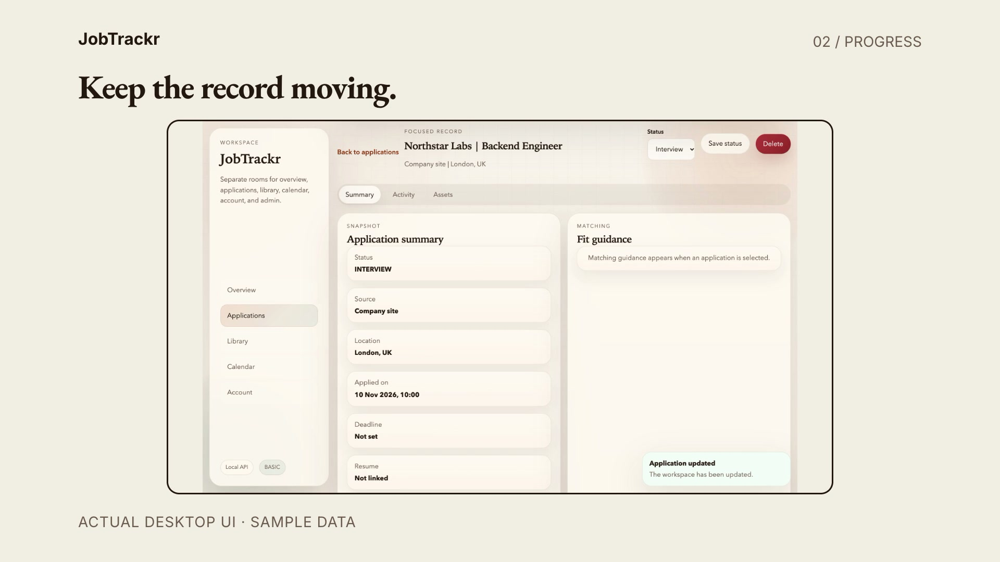

# Frontend Workspace

This directory contains the React/Vite source for the JobTrackr browser UI.

## Responsive video demo

[](../docs/videos/desktop.mp4)

Watch: [Desktop (16:9)](../docs/videos/desktop.mp4) · [Tablet (4:3)](../docs/videos/tablet.mp4) · [Phone (9:16)](../docs/videos/mobile.mp4)

Application queue → focused record → status update → calendar and follow-ups. All three editions use the real React frontend at their corresponding responsive layouts: 1440×900 desktop, 1024×768 tablet and 390×844 phone. Smaller layouts stack panels and move navigation above the content; captures are scrolled to the relevant sections.

These edited demos use fictional applications and local fixture responses, not a production backend session or real applicant data. GitHub README video versions are selected manually.

<details>
<summary>Media credits</summary>

[Music and sound-effect credits](../docs/videos/credits.txt).

</details>

## Core Routes

- `#/overview`: dashboard, recommendations, and upcoming events
- `#/applications`: application queue, sorting, paging, and creation
- `#/applications/:id`: focused application workspace
- `#/library`: reusable resumes, cover letters, sources, and locations
- `#/calendar`: event filtering and exports
- `#/account`: profile and account lifecycle
- `#/admin`: admin-only user and audit views

## Commands

Install dependencies:

```bash
npm install
```

Run the Vite dev server:

```bash
npm run dev
```

Build the production bundle that Spring Boot serves:

```bash
npm run build
```

## Output

The production build is written to `../src/main/resources/static`.

- `index.html`: Spring-served entry shell
- `assets/*.js`: compiled React application bundle
- `assets/*.css`: compiled styles

Treat `src/main/resources/static` as build output, not source code.

## API Flow

The frontend talks to the same-origin backend in production. During local frontend development, the Vite dev server proxies `/api` requests to `http://localhost:8081/`.
